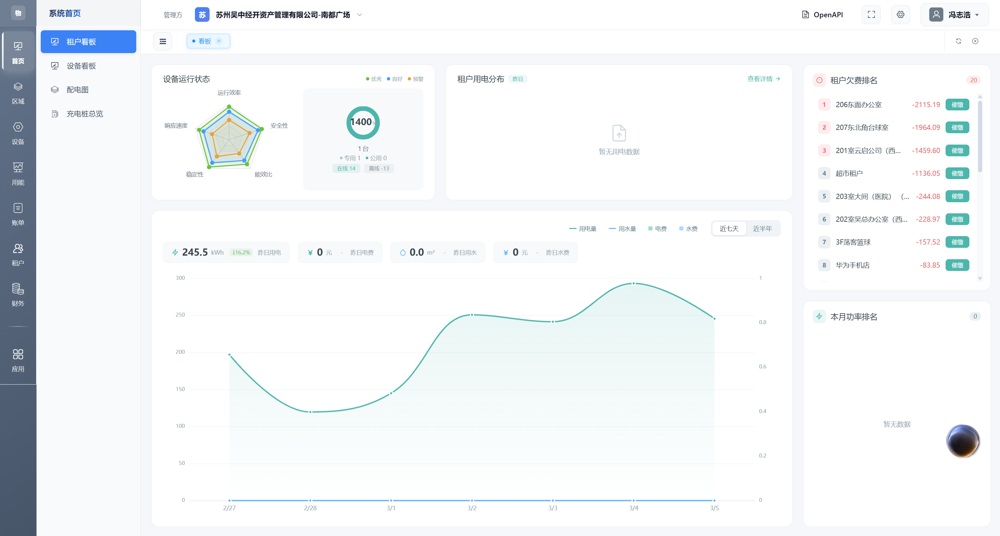
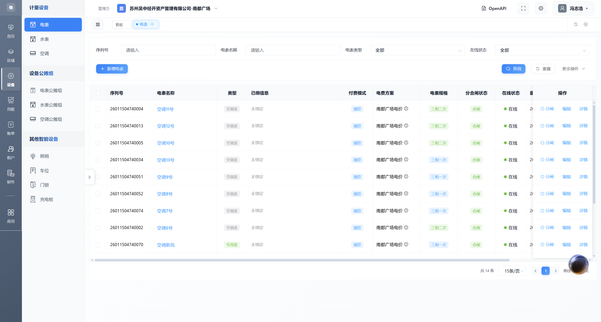
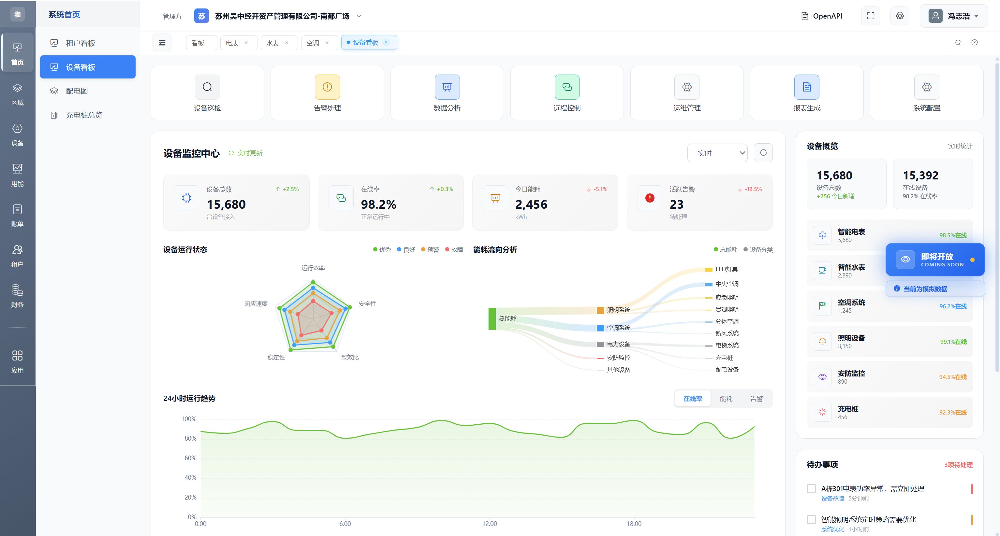
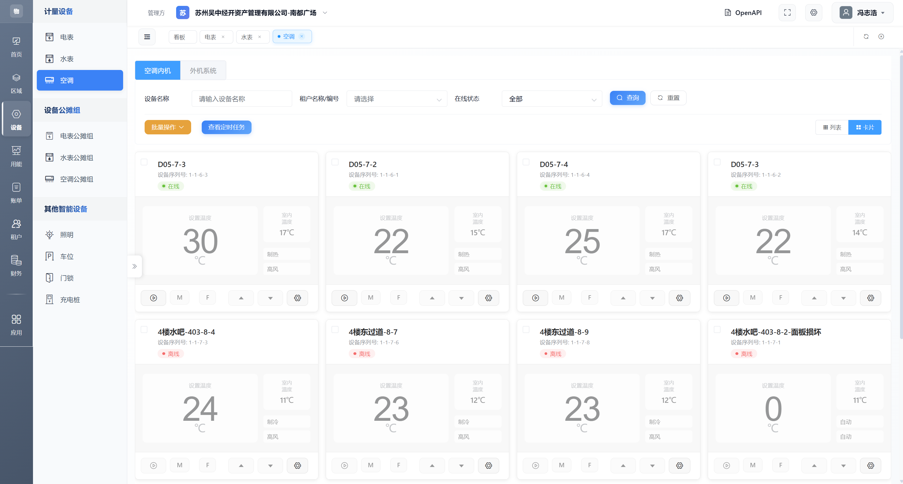
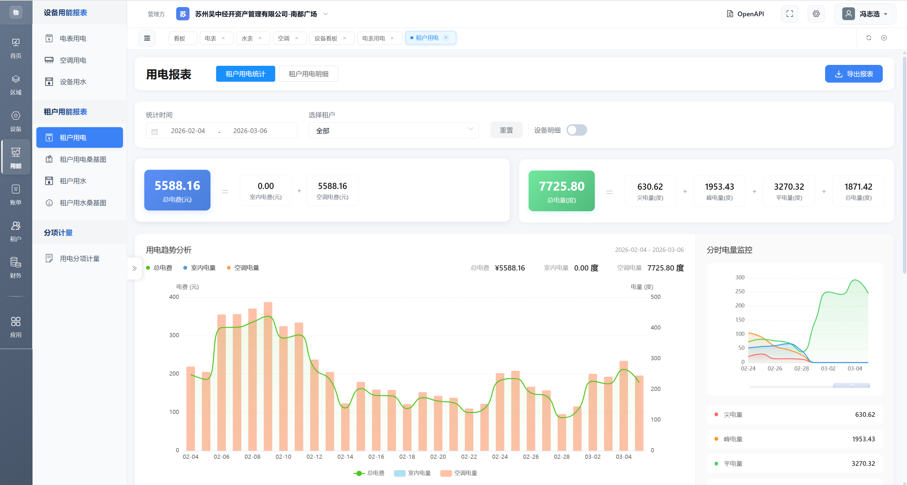
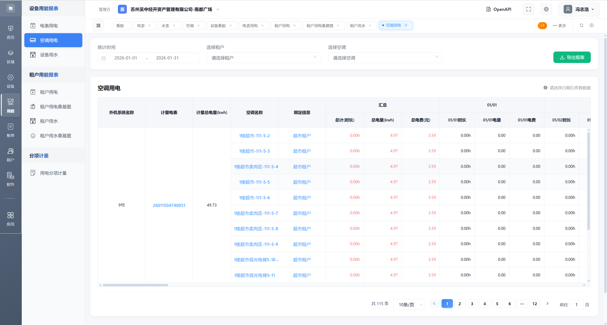
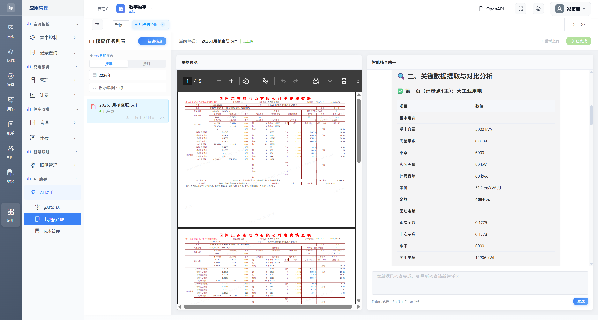
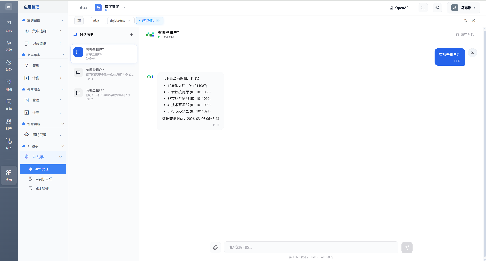

# 数字物宇-多联机中央空调集控+计费系统

面向智慧楼宇与数字能源的企业级前端项目，聚焦“多联机中央空调集控 + 计费 + 能耗分析 + 运营”。遵循 AI Native 能源管理理念，基于云-管-端架构与 IoT + AI + Data 能力，支撑设备统一接入、能耗精细化管理与运营协同，满足百万设备并发与 99.99% 可用性目标。

- 系统地址：https://iot.geekpartytech.com/
- 产品介绍：https://vrf.geekpartytech.com/
- 演示账号：18866668888
- 演示密码：Demo@2025

## 核心能力
- 多品牌统一管控：兼容主流 VRF 厂商与 200+ 协议，统一接入与控制
- 精准分户计量：冷量/电量分户与账单溯源，预付费模式零欠费
- 集控与调度：设备组控、时序调度、运行日志与异常处理
- 能源分析：电/水报表、桑基图、设备功率与用能分布、节能对比
- 计费与结算：费率管理、分摊、浮动电价、手工账单与对账核验
- 运营协同：租户管理、充值退款、发票、资金流水、工单与告警
- AI Agent：费用智能核验与预测、故障分析与策略推荐

## 系统架构
- 应用层：物业管理端、租户小程序、工程 App、开放 API
- 平台层：设备管理、计费引擎、告警中心、数据分析中台
- 边缘层：品牌网关、LoRa/NB/4G 通信模块、边缘计算与协议转换
- 设备层：主流 VRF 与配套仪表；断网可脱机运行，数据本地缓存与同步

## 企业级特性
- 高可用与并发：目标 99.99% 可用性与百万级并发，前后端解耦，具备弹性扩展能力
- 安全与治理：角色/菜单权限、操作审计、异常留痕、数据分级与多租户隔离
- 可观测性：全链路告警中心、运行日志、策略触发与故障码解析，支持报表留档
- 合规与隐私：不落地敏感凭据，前后端分离的密钥管理；支持 HTTPS 与域策略
- 可维护性：策略模板化复用、工程模式批量控制、维护窗口与变更日志

## 开放生态
- 接口形态：REST API、WebSocket、Webhook 与 SDK（示例与文档可在系统内查看）
- 协议兼容：Modbus、BACnet、LonWorks 以及多品牌私有协议融合
- 集成能力：与照明、门锁、停车等子系统联动；支持第三方数据源对接

## 技术栈
- 前端：Vue CLI、Vue Router、Vuex、Element UI
- 可视化：ECharts、Konva
- 工具：Axios、Ali-OSS、Mock.js、Moment、xlsx
- PWA：register-service-worker，图标路径经 vue.config.js 配置
- 测试：@vue/cli-plugin-unit-mocha + @vue/test-utils + chai

## 目录结构
```
wyy-admin/
├─ public/                # 静态资源与模板 (index.html, favicon 等)
│  ├─ img/icons/          # PWA 图标
│  └─ robots.txt
├─ src/
│  ├─ api/                # 按领域划分的接口模块 (空调/水电/计费/租户/财务等)
│  ├─ assets/             # 样式与图片 (floors SVG 使用自定义 loader)
│  ├─ components/         # 公共组件 (Breadcrumb、Pagination、TagsView 等)
│  ├─ layout/             # 应用布局 (Navbar、Sidebar、AppMain)
│  ├─ mock/               # 本地模拟数据
│  ├─ router/             # 全局路由
│  ├─ store/              # Vuex 模块 (app、permission、user 等)
│  ├─ utils/              # 请求封装/鉴权/菜单路由/校验工具
│  ├─ views/              # 业务页面
│  │  ├─ console/         # 设备/计费/能源/AI 助手等控制台模块
│  │  ├─ device/          # 设备详情与协同 (空调/水表/电表/照明/门锁/停车)
│  │  ├─ energy/          # 能源报表/桑基图/设备功率
│  │  ├─ fee/             # 费率与服务方案
│  │  ├─ finance/         # 资金流水/提现/退款/发票
│  │  ├─ tenant/          # 租户档案/设备/账单/交易
│  │  ├─ parking/         # 计费与规则配置
│  │  ├─ dashboard/       # 运营看板与统计
│  │  ├─ login/           # 登录页
│  │  ├─ system/          # 用户/角色/菜单权限
│  │  ├─ operator/        # 运维变更日志与管理
│  │  ├─ order/           # 订单列表与详情
│  │  ├─ report/          # 报表 (概览/销售/用户)
│  │  ├─ ApiDocs.vue      # API 使用说明入口
│  │  ├─ 401.vue / 404.vue
│  │  └─ ...
│  ├─ App.vue
│  ├─ main.js
│  ├─ permission.js
│  └─ settings.js
├─ tests/unit/            # 单元测试示例
├─ .env.development       # 开发环境变量
├─ .env.production        # 生产环境变量
├─ vue.config.js          # 开发服务器/代理与 floors SVG loader 自定义
├─ babel.config.js
├─ .eslintrc.js
├─ .editorconfig
├─ .browserslistrc
└─ package.json
```

## 环境要求
- Node.js >= 14（推荐 16/18 LTS）
- npm >= 7

## 快速开始
```bash
npm install
npm run serve
```
- 本地开发地址：http://localhost:8080
- 代理配置：`/api` → `https://iot-test.geekpartytech.com`（详见 vue.config.js）

## 构建与测试
```bash
npm run build      # 生产构建
npm run test:unit  # 单元测试
npm run lint       # 代码规范检查与修复
```

## 环境变量
- 开发环境（.env.development）
  - VUE_APP_BASE_API=/dev-api
  - VUE_APP_HTTPS=false
  - PORT=8080
  - OPEN=true
- 生产环境（.env.production）
  - VUE_APP_BASE_API=https://api.yourdomain.com
  - VUE_APP_HTTPS=true
> 说明：实际 API 域名与 HTTPS 策略以部署环境为准，通过环境变量注入。

## 部署指南
- 生产构建产物可部署至任意 Web 服务器或 CDN。
- 确保后端 API 与 `VUE_APP_BASE_API` 对齐，必要时在网关配置反向代理。
- PWA 图标路径在 `vue.config.js` 的 `pwa.iconPaths` 中已统一为 `favicon.ico`。

## 安全与合规
- 不在仓库中存储敏感密钥；Ali-OSS 等凭据通过后端签名或环境变量注入。
- 演示账号与密码仅用于体验环境，勿用于生产。
- 前端层面采用输入校验与 DOMPurify 等策略防止 XSS。

## 接口与封装
- `src/utils/request.js` 基于 Axios 封装，统一拦截器与错误处理。
- `src/api/` 下按领域拆分接口文件（如 `airCondition.js`、`meter.js`、`billDetailApi.js`、`tenant.js`、`finance` 等）。

## 业务模块导航
- Conditioning：集控、抄表、运行日志、调度器
- Billing：能耗账单、分摊、浮动电价、手工账单
- Energy：电/水报表、桑基图、设备功率
- Finance：资金流水、提现、退款、发票
- Tenant：租户档案、设备、账单、交易
- Device：空调/水表/电表/照明/门锁/停车
- Parking：计费与规则配置
- System：用户/角色/菜单权限
- Dashboard：运营看板与统计

## 演示与截图
### 租户看板 · KPI 与运营漏斗

租约/账期状态、能耗环比与目标对比、预付费余额与催缴提醒、异常告警汇总与处理 SLA。支持按租户/楼层/业态多维筛选与权限隔离，大屏 1920+ 自适应。

### 电表 · 分项计量与费率时段

支持峰谷平费率、需量与功率因数监控、异常波动检测与工单联动；抄表周期、对账核验与导出留痕，账单可追溯到仪表数据源。

### 设备大屏 · 在线率与能耗热力

楼层分层 3D/平面融合展示，设备在线率、能耗热力图和告警态势一屏总览；提供批量控制入口与维护窗口期提醒，支持工程模式。

### 空调 · 组控与时序调度

按区域/租户进行组控，策略模板复用；支持日/周时序调度、节能策略与联动条件配置；运行日志与故障码解析可追溯。

### 用电报表 · 成本分析与节能对比

按分区/租户/时间维度对比，峰谷平结构与成本贡献分析；节能改造前后对比与基准线评估，支持 XLSX 导出与图表嵌入。

### 空调设备数据 · 多维运行画像

展示冷量、回风/送风、开停机时长、能效比与健康评分；联动策略触发记录与异常埋点，支持按设备/策略筛选。

### 分项计量与电费核查 · AI 解释与建议

账单溯源到分项数据，异常账单核验与原因分析；AI 提供费用分摊合理性评估与优化建议，支持一键生成核查报告。

### 基于 AI 的智能对话 · 调度与问答

支持指标问答、故障定位、节能策略推荐与可执行指令确认；对话上下文关联多源数据，满足物业与工程双角色使用。

## 部署形态
- SaaS：开箱即用，按租户与项目维度授权，支持快速扩展
- 私有化：与企业网关/协议栈对接，支持本地边缘节点与容灾方案
- OEM/集成：品牌与域名可定制，接口与策略按项目场景深度融合

## 开源与贡献
- 我们开放源代码，欢迎 Issue 与 PR
- 建议遵循通用提交规范，说明变更范围与影响面，并附带复现步骤或截图
- 新增功能请同时补充文档或示例入口，便于持续维护

 

## 相关链接
- 极派科技官网：https://geekpartytech.com/
- 数字物宇-物联中台：https://iot.geekpartytech.com/
